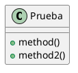

### Detectar métodos sin tipo de retorno:

Un método sin tipo de retorno es un elemento de una clase concreta, abstracta o de una interfaz que posee paréntesis al final del nombre del elemento pero no posee el tipo definido ni inmediatamente antes del nombre, ni después del nombre y del elemento `:`.

Dentro de una clase definida: `- metodo()` es un método sin tipo de retorno, mientras que `- int metodo()` y `- metodo() : int` no lo son.

Formas posibles de definir métodos sin tipo:

Con las distintas variantes para `classDeclaration`: `class | abstract | interface`.
