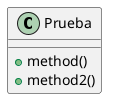

### Detectar métodos sin tipo de retorno:

Un método sin tipo de retorno es un elemento de una clase concreta, abstracta o de una interfaz que posee paréntesis al final del nombre del elemento pero no posee el tipo definido ni inmediatamente antes del nombre, ni después del nombre y del elemento `:`.

Dentro de una clase definida: `- metodo()` es un método sin tipo de retorno, mientras que `- int metodo()` y `- metodo() : int` no lo son.

Formas posibles de definir métodos sin tipo:

Con las distintas variantes para `classDeclaration`: `class | abstract | interface`.

# Tests que deberían devolver que el diagrama contiene métodos sin tipo de retorno: 
  1. class| interface| abstract Prueba{+ method()} 
  2. class| interface| abstract Prueba{- method()} 
  3. class| interface| abstract Prueba{# method()} 
  4. class| interface| abstract Prueba{method()}  
  5. class| interface| abstract Prueba{+ calcular(int a, int b)} 
  6. class| interface| abstract Prueba{+ setX(x : int)} 
  7. class| interface| abstract Prueba{+ setY(y)} 
  8. class| interface| abstract Prueba{+ {abstract} validar()} 
  9. class| interface| abstract Prueba{+ {static} crear()} 
  10. Prueba : + method() 
  11. Prueba : methodo() 
# Tests que no deberían devolver nada: 
  1. class| interface| abstract Prueba{+ int method()} 
  2. class| interface| abstract Prueba{+ method() : int} 
  3. class| interface| abstract Prueba{+ void guardar(String ruta)} 
  4. class| interface| abstract Prueba{+ method() : void} 
  5. class| interface| abstract Prueba{+ List<String> listar()} 
  6. class| interface| abstract Prueba{+ listar() : List<String>} 
  7. class| interface| abstract Prueba{+ int[] ids()} 
  8. class| interface| abstract Prueba{+ nombre : String} 
  9. class| interface| abstract Prueba{+ nombre} 
  10. class| interface| abstract Prueba{nombre} 
  11. Prueba : + method() : int 
  12. Prueba : + int method() 
  13. enum| entity| annotation| exception| metaclass| stereotype| protocol| struct Prueba{+metodo()} 
