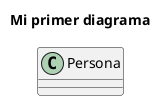

# PlantUML

## ¿Qué es PlantUML?

**PlantUML** es una herramienta que permite dibujar diagramas UML escribiéndolos como texto. En lugar de arrastrar cajas y flechas con el mouse, describís el diagrama con una sintaxis simple y PlantUML se encarga de dibujarlo.

Al ser texto plano, los diagramas se pueden versionar con Git, comparar entre versiones y, lo que nos interesa en este proyecto, **analizar con un parser** para buscar problemas de diseño.

Si querés conocer más, podés visitar el [sitio oficial](https://plantuml.com/es/class-diagram) o probar tus diagramas en el [servidor online](https://www.plantuml.com/plantuml/uml/), que los dibuja a medida que escribís.

## Capacidades de la gramática

En este repositorio hay una gramática de ANTLR4 para PlantUML ([`PlantUmlLexer.g4`](../../src/main/antlr4/PlantUmlLexer.g4) y [`PlantUmlParser.g4`](../../src/main/antlr4/PlantUmlParser.g4)), pero es reducida: solo cubre **diagramas de clases**. A continuación se muestran ejemplos de lo que se puede escribir.

### Estructura del diagrama

Todo diagrama empieza con `@startuml` y termina con `@enduml`. Los ejemplos de las secciones siguientes van siempre entre esas dos líneas.



### Clases, atributos y métodos

Se aceptan tanto el estilo UML (`nombre : Tipo`) como el estilo Java (`Tipo nombre`).

```plantuml
class Persona {
    -nombre : String
    -edad : int = 0
    +getNombre() : String
    +saludar(otra : Persona) : void
    +void cumplirAnios()
}
```

### Visibilidad y modificadores

| Símbolo | Visibilidad |
|:-------:|-------------|
| `+`     | pública     |
| `-`     | privada     |
| `#`     | protegida   |
| `~`     | de paquete  |

```plantuml
class Contador {
    - {static} instancias : int
    # valor : int
    +{static} getInstancias() : int
    +{abstract} incrementar() : void
}
```

> [!WARNING]
> Mirá la sección [Limitaciones conocidas](#limitaciones-conocidas): `#` y `-{static}` necesitan un espacio.

### Clases abstractas, interfaces y enumerativos

```plantuml
abstract class Figura {
    +{abstract} area() : double
}

interface Dibujable {
    +dibujar() : void
}

enum Color {
    ROJO
    VERDE
    AZUL
}
```

### Herencia e implementación

Se pueden declarar dentro de la clase:

```plantuml
class Circulo extends Figura implements Dibujable {
    -radio : double
}
```

### Tipos genéricos

```plantuml
class Biblioteca<T> {
    -libros : List<Libro>
    -indice : Map<String, Libro>
}
```

### Estereotipos, colores y alias

```plantuml
class Banco <<Singleton>> #LightBlue
class "Cuenta Corriente" as CC
```

### Separadores dentro de una clase

```plantuml
class Cuenta {
    -saldo : double
    --
    +getSaldo() : double
}
```

### Miembros declarados fuera de la clase

```plantuml
Persona : +getEdad() : int
Persona : -dni : String
```

### Relaciones

```plantuml
Animal <|-- Perro
Circulo ..|> Dibujable
Auto *-- Motor
Equipo o-- Jugador
Alumno --> Curso
Cliente .. Pedido
Persona -up-> Direccion
```

Con cardinalidad y etiqueta:

```plantuml
Biblioteca "1" *-- "*" Libro : contiene
```

### Paquetes

```plantuml
package banco {
    class Cuenta
    class Cliente
}
```

### Notas

```plantuml
note left of Cuenta : una nota de una línea

note right of Cuenta
    Una nota
    de varias líneas.
end note

note "Nota flotante" as N1
```

### Comentarios y directivas

```plantuml
' Esto es un comentario de una línea
/' Esto es un comentario
   de varias líneas '/
left to right direction
skinparam classAttributeIconSize 0
hide empty members
```

## Limitaciones conocidas

Estas construcciones son válidas en PlantUML pero esta gramática las interpreta mal:

- **Visibilidad protegida pegada al nombre**: `#color` se reconoce como un color (como `#LightBlue`), no como `#` + `color`. Escribí `# color` (con espacio).
- **Modificadores pegados al `-`**: `-{static}` se reconoce como una flecha (`-{`). Escribí `- {static}` (con espacio). Con `+`, `#` y `~` no pasa.
- **Palabras reservadas como nombres**: no se pueden usar como nombre de clase o atributo palabras como `class`, `note`, `end`, `title`, `left`, `to`, `as`, `of`, etc.
- Solo se reconocen **diagramas de clases** (no de secuencia, de casos de uso, etc.).

## Ejemplos

En la carpeta [`Examples`](./Examples/) hay diagramas completos que la gramática reconoce. El de [`reporte.puml`](./Examples/reporte.puml) tiene el "olor" que detecta el [Print Sniffer](../Print%20Sniffer/Print%20Sniffer.md).
