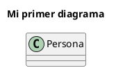

# PlantUML

[PlantUML](https://plantuml.com/es/class-diagram) dibuja diagramas UML a partir de texto. Como los diagramas son texto plano, se pueden versionar con Git y, lo que importa acá, parsear para buscar problemas de diseño. Para ver cómo queda un diagrama, pegalo en el [servidor online](https://www.plantuml.com/plantuml/uml/).

## Qué acepta la gramática

La gramática del proyecto ([`PlantUmlLexer.g4`](../../src/main/antlr4/oo2/redictado/plantuml/antlr4/PlantUmlLexer.g4) y [`PlantUmlParser.g4`](../../src/main/antlr4/oo2/redictado/plantuml/antlr4/PlantUmlParser.g4)) cubre solo una parte de PlantUML: los diagramas de clases. Todos los ejemplos de esta sección se parsean sin errores.

### Estructura del diagrama

Todo diagrama empieza con `@startuml` y termina con `@enduml`. En los ejemplos que siguen se omiten esas dos líneas.



### Clases, atributos y métodos

Se acepta tanto el estilo UML (`nombre : Tipo`) como el de Java (`Tipo nombre`).

```plantuml
class Persona {
    -nombre : String
    -edad : int = 0
    +getNombre() : String
    +saludar(otra : Persona) : void
    +void cumplirAnios()
}
```

### Visibilidad y modificadores

| Símbolo | Visibilidad |
|:-------:|-------------|
| `+`     | pública     |
| `-`     | privada     |
| `#`     | protegida   |
| `~`     | de paquete  |

```plantuml
class Contador {
    - {static} instancias : int
    # valor : int
    +{static} getInstancias() : int
    +{abstract} incrementar() : void
}
```

`#` y `-` necesitan un espacio antes del nombre o del modificador; ver [Limitaciones](#limitaciones).

### Clases abstractas, interfaces y enumerativos

```plantuml
abstract class Figura {
    +{abstract} area() : double
}

interface Dibujable {
    +dibujar() : void
}

enum Color {
    ROJO
    VERDE
    AZUL
}
```

### Herencia e implementación

Se pueden declarar dentro de la clase:

```plantuml
class Circulo extends Figura implements Dibujable {
    -radio : double
}
```

### Tipos genéricos

```plantuml
class Biblioteca<T> {
    -libros : List<Libro>
    -indice : Map<String, Libro>
}
```

### Estereotipos, colores y alias

```plantuml
class Banco <<Singleton>> #LightBlue
class "Cuenta Corriente" as CC
```

### Separadores dentro de una clase

```plantuml
class Cuenta {
    -saldo : double
    --
    +getSaldo() : double
}
```

### Miembros declarados fuera de la clase

```plantuml
Persona : +getEdad() : int
Persona : -dni : String
```

### Relaciones

```plantuml
Animal <|-- Perro
Circulo ..|> Dibujable
Auto *-- Motor
Equipo o-- Jugador
Alumno --> Curso
Cliente .. Pedido
Persona -up-> Direccion
```

Con cardinalidad y etiqueta:

```plantuml
Biblioteca "1" *-- "*" Libro : contiene
```

### Paquetes

```plantuml
package banco {
    class Cuenta
    class Cliente
}
```

### Notas

```plantuml
note left of Cuenta : una nota de una línea

note right of Cuenta
    Una nota
    de varias líneas.
end note

note "Nota flotante" as N1
```

### Comentarios y directivas

```plantuml
' Esto es un comentario de una línea
/' Esto es un comentario
   de varias líneas '/
left to right direction
skinparam classAttributeIconSize 0
hide empty members
```

## Limitaciones

Estas construcciones son válidas en PlantUML pero la gramática no las acepta:

- `#color`: el lexer lo toma como un color, igual que `#LightBlue`. Escribí `# color`.
- `-{static}`: el lexer lo toma como el principio de una flecha. Escribí `- {static}`. Con `+`, `#` y `~` no pasa.
- Multiplicidades en el tipo, como `notas : Integer[*]`. `Integer[]` sí se acepta.
- Palabras reservadas como nombres de clases o atributos: `class`, `note`, `end`, `title`, `left`, `to`, `as`, `of`, etc.
- Diagramas que no sean de clases (de secuencia, de casos de uso, etc.).

## Ejemplos

En [`Examples`](./Examples/) hay diagramas completos que la gramática acepta. [`reporte.puml`](./Examples/reporte.puml) tiene el olor que detecta el [Print Sniffer](../Print%20Sniffer/Print%20Sniffer.md).
