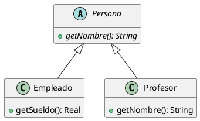

# Unimplemented Abstract Method Sniffer


Detecta clases concretas que no implementan los métodos abstractos declarados en su superclase directa.


Que una clase concreta herede un método abstracto sin implementarlo indica una inconsistencia en el modelo: la clase no podría instanciarse, o el diseño de la jerarquía no está terminado.


## Qué cuenta como implementación


Un método abstracto (`{abstract}`) de la superclase directa se considera implementado si la clase concreta declara un método no `{abstract}` con:


- la misma visibilidad (`#` no es lo mismo que `+`);
- el mismo nombre, distinguiendo mayúsculas;
- los mismos tipos de parámetros en el mismo orden (los nombres de los parámetros no importan);
- el mismo tipo de retorno.


No se asumen valores por defecto, porque el diagrama es UML general y no está ligado a Java. Una visibilidad o un tipo de retorno no declarados quedan vacíos, y un valor vacío solo coincide con otro vacío: `m()` no implementa `+m()` ni `#m()`, y `m()` no es lo mismo que `m(): void`. Los espacios dentro de los tipos se ignoran.


Los miembros `{static}` no se consideran en absoluto: no generan obligaciones, aunque sean `{abstract}`, ni cuentan como implementación.


La superclase puede ser abstracta o concreta, porque en UML una clase concreta puede declarar un método `{abstract}`. Las clases abstractas nunca se reportan.


## Cómo encuentra la herencia y los métodos


- Herencia con `extends` (`class Hija extends Padre`) o con flechas de generalización (`Padre <|-- Hija`, `Hija --|> Padre`). Las flechas punteadas (`..|>`) son realizaciones de interfaces y se ignoran.
- Métodos dentro del cuerpo de la clase o fuera de él (`Clase : +metodo()`).


Primero recorre todo el diagrama armando objetos `Clase` y `Metodo`, y recién al final conecta cada clase con su superclase, porque las flechas pueden aparecer antes que las clases. La lógica del olor está en esos objetos: `Metodo.implementa(abstracto)` compara dos métodos y `Clase.metodosSinImplementar()` devuelve los métodos abstractos de la superclase que la clase no implementa. El visitor solo construye el modelo y reporta.


Agrega un aroma por cada clase culpable, en la línea donde está declarada, con las firmas que le faltan.


## Alcance y limitaciones


- Solo clases con herencia simple. Las interfaces, los enums y las clases con más de un padre quedan fuera.
- Lo que no figura en el diagrama se asume inexistente: si la superclase no está en el diagrama, no hay obligaciones.
- Solo mira la superclase directa. En `A (abstract m) ← B (abstracta, sin m) ← C (concreta, sin m)` no reporta a `C`.
- Un método `{abstract}` en una clase concreta no se reporta por sí mismo.


## Ejemplo





```bash
mvn -q compile exec:java -Dexec.args="--sniffers UnimplementedAbstractMethodSniffer diagrama.puml"
```


```text
[UnimplementedAbstractMethodSniffer] line 5: La clase concreta Empleado no implementa los métodos abstractos de su superclase Persona: +getNombre():String
```