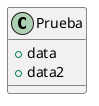

### Detectar variables sin tipo:

Una variable sin tipo es un elemento de una clase concreta, abstracta o de una interfaz que no posee paréntesis al final del nombre del elemento y que no tiene ninguna palabra que defina su tipo inmediatamente antes del nombre o que lo defina a posterior mediante la utilización de `:` y el nombre del tipo.

Dentro de una clase definida, `- variable` es una variable sin tipo, mientras que `- int variable` y `- variable : int` no lo son.

Formas posibles de definir variables sin tipo:

Con las distintas variantes para `classDeclaration`: `class | abstract | interface`.
