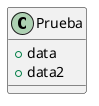

### Detectar variables sin tipo:

Una variable sin tipo es un elemento de una clase concreta, abstracta o de una interfaz que no posee paréntesis al final del nombre del elemento y que no tiene ninguna palabra que defina su tipo inmediatamente antes del nombre o que lo defina a posterior mediante la utilización de `:` y el nombre del tipo.

Dentro de una clase definida, `- variable` es una variable sin tipo, mientras que `- int variable` y `- variable : int` no lo son.
Formas posibles de definir variables sin tipo:

Con las distintas variantes para `classDeclaration`: `class | abstract | interface`.

# Tests que deberían devolver que el diagrama contiene variables sin tipo: 
  1. class| interface| abstract Prueba{+ data} 
  2. class| interface| abstract Prueba{- variable} 
  3. class| interface| abstract Prueba{# variable} 
  4. class| interface| abstract Prueba{~variable} 
  5. class| interface| abstract Prueba{variable} 
  6. class| interface| abstract Prueba{+{static} contador} 
  7. class| interface| abstract Prueba{ + pin = 1234 }
  8. Prueba : + data2 
  9. Prueba : data3 
  10. Prueba : - pin = 1234 
# Tests que no deberían devolver nada: 
  1. class| interface| abstract Prueba{+ int variable} 
  2. class| interface| abstract Prueba{- int variable} 
  3. class| interface| abstract Prueba{- variable : int} 
  4. class| interface| abstract Prueba{+ lista : List<String>} 
  5. class| interface| abstract Prueba{+ List<String> lista} 
  6. class| interface| abstract Prueba{+ ids : int[]} 
  7. class| interface| abstract Prueba{+ int[] ids} 
  8. class| interface| abstract Prueba{ - pin : int = 1234 } 
  9. class| interface| abstract Prueba{+ getX() : int} 
  10. class| interface| abstract Prueba{+ method()} 
  11. class| interface| abstract Prueba{+ setX(x)} 
  12. Prueba : + data2 : String 
  13. Prueba : + String data2 
  14. enum| entity| annotation| exception| metaclass| stereotype| protocol| struct Prueba{+data} 
