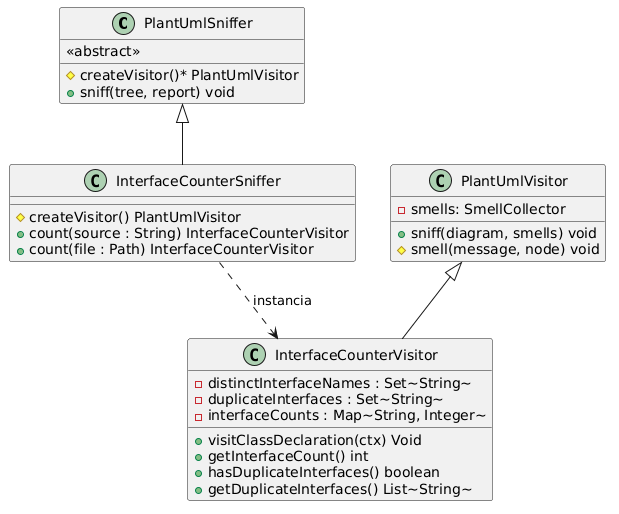
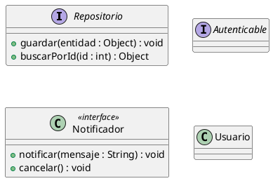

# Explicación del Código: `ejemploDeUso`

Este módulo implementa un análisis sobre diagramas de clases PlantUML (`.puml`) para:
1. **Contar las interfaces** presentes en el diagrama.
2. **Detectar interfaces duplicadas** (declaradas más de una vez con el mismo nombre).
3. **Listar las duplicadas** y reportarlas como un mal olor (*smell*) indicando el número de línea.

Todo el código está contenido en solo **dos clases**: [`InterfaceCounterSniffer`](../../ejemploDeUso/InterfaceCounterSniffer.java) e [`InterfaceCounterVisitor`](../../ejemploDeUso/InterfaceCounterVisitor.java).

---

## 1. Estructura y Responsabilidad de las Dos Clases



### 1. `InterfaceCounterSniffer`
* **Rol:** Es la clase principal que se conecta con el framework `uml-smell-finder`.
* **Herencia:** Extiende de `PlantUmlSniffer`.
* **Qué hace:**
  * Implementa `createVisitor()`, donde simplemente devuelve un `new InterfaceCounterVisitor()`.
  * Provee métodos auxiliares `count(String source)` y `count(Path file)` para que puedas analizar un diagrama directamente sin necesidad de instanciar manualmente el orquestador del framework.

### 2. `InterfaceCounterVisitor`
* **Rol:** Es la clase que inspecciona los elementos del diagrama a medida que ANTLR4 recorre el árbol de sintaxis.
* **Herencia:** Extiende de `PlantUmlVisitor`.
* **Qué hace:**
  * Redefine el método `visitClassDeclaration(...)` para revisar cada clase o interfaz declarada.
  * Lleva el conteo de interfaces únicas y detecta si un nombre se repite.
  * Si encuentra un nombre repetido, registra el mal olor llamando a `smell(...)`.

---

## 2. Cómo Funciona el Código Paso a Paso

### 2.1. Las variables donde se guarda la información
En `InterfaceCounterVisitor`:

```java
// Guarda cada nombre de interfaz una sola vez (para el conteo único)
private final Set<String> distinctInterfaceNames = new LinkedHashSet<>();

// Guarda únicamente los nombres de las interfaces que están duplicadas
private final Set<String> duplicateInterfaces = new LinkedHashSet<>();

// Cuenta cuántas veces apareció cada nombre (ej: {"Repositorio": 2, "Autenticable": 1})
private final Map<String, Integer> interfaceCounts = new LinkedHashMap<>();
```

* Usamos `LinkedHashSet` y `LinkedHashMap` para que los elementos conserven el mismo orden en el que fueron leídos en el archivo `.puml`.

---

### 2.2. Cómo saber si un elemento es una interfaz
En PlantUML una interfaz puede escribirse de dos maneras:
1. Con la palabra clave `interface`:
   ```plantuml
   interface Repositorio
   ```
2. O como una clase con el estereotipo `<<interface>>`:
   ```plantuml
   class Notificador <<interface>>
   ```

El método `isInterface(...)` revisa ambas opciones:
```java
private boolean isInterface(PlantUmlParser.ClassDeclarationContext ctx) {
    // 1. Revisa si tiene la palabra clave "interface"
    String kind = ctx.classKind() != null ? ctx.classKind().getText().toLowerCase() : "";
    if ("interface".equals(kind)) {
        return true;
    }
    // 2. Revisa si tiene el estereotipo <<interface>>
    PlantUmlParser.ClassTailContext tail = ctx.classTail();
    if (tail != null && tail.stereotype() != null) {
        return tail.stereotype().getText().toLowerCase().contains("interface");
    }
    return false;
}
```

---

### 2.3. Detección de duplicados en `visitClassDeclaration`
Cada vez que ANTLR encuentra una declaración en el diagrama, llama a `visitClassDeclaration`:

```java
@Override
public Void visitClassDeclaration(PlantUmlParser.ClassDeclarationContext ctx) {
    String name = extractName(ctx.className()); // Extrae el nombre limpio (sin comillas)

    if (isInterface(ctx)) {
        allInterfaceNames.add(name);

        // Sumamos 1 a las apariciones de esta interfaz
        int count = interfaceCounts.getOrDefault(name, 0) + 1;
        interfaceCounts.put(name, count);

        if (count > 1) {
            // ¡Ya había aparecido antes! Es un duplicado.
            duplicateInterfaces.add(name);
            String msg = "Interface duplicada: " + name;
            smell(msg, ctx); // Notifica el mal olor al framework indicando la línea
        } else {
            // Es la primera vez que aparece: la registramos normalmente
            distinctInterfaceNames.add(name);
            classNames.remove(name);
        }
    } else if (isClass(ctx) && !distinctInterfaceNames.contains(name)) {
        classNames.add(name);
    }

    // Procesa los métodos dentro del cuerpo { ... }
    PlantUmlParser.ClassTailContext tail = ctx.classTail();
    if (tail != null && tail.classBody() != null) {
        for (PlantUmlParser.BodyItemContext item : tail.classBody().bodyItem()) {
            if (item.member() != null && item.member().memberSignature() != null
                    && item.member().memberSignature().methodSignature() != null) {
                addMethod(name, item.member().visibility(), item.member().memberSignature().methodSignature());
            }
        }
    }

    // Sigue recorriendo los nodos hijos del árbol
    return visitChildren(ctx);
}
```

#### Puntos clave:
* **¿Cómo se detecta el duplicado?** Si `count > 1`, significa que ese nombre de interfaz ya había sido visto.
* **¿Cómo se reporta la línea?** Al llamar a `smell(msg, ctx)`, el framework toma automáticamente la línea del archivo donde comenzó ese nodo (`ctx.getStart().getLine()`).
* **`visitChildren(ctx)`**: Es obligatorio para que ANTLR continúe recorriendo los miembros y métodos dentro del cuerpo de la clase o interfaz.

---

## 3. Ejemplo Práctico de Detección

En [`ejemplo.puml`](./ejemplo.puml) tenemos el siguiente diagrama de prueba:



### Resultados que produce el análisis:
* **Interfaces únicas encontradas:** `3` (`Repositorio`, `Autenticable`, `Notificador`)
* **Total declaraciones de interfaces:** `5`
* **Interfaces duplicadas:** `[Repositorio, Notificador]`
* **Olores reportados por el framework:**
  ```text
  [InterfaceCounterSniffer] line 20: Interface duplicada: Repositorio
  [InterfaceCounterSniffer] line 25: Interface duplicada: Notificador
  ```

---

## 4. Métodos para Consultar los Resultados

Desde `InterfaceCounterVisitor` podés consultar directamente:

| Método | Qué devuelve | Ejemplo con el diagrama anterior |
| :--- | :--- | :--- |
| `getInterfaceCount()` | Cantidad de interfaces distintas | `3` |
| `getTotalInterfaceCount()` | Cantidad total de declaraciones de interfaces | `5` |
| `getInterfaces()` | Conjunto de nombres de interfaces | `["Repositorio", "Autenticable", "Notificador"]` |
| `hasDuplicateInterfaces()` | Booleano: `true` si hay alguna duplicada | `true` |
| `getDuplicateInterfaces()` | Lista con los nombres de las interfaces duplicadas | `["Repositorio", "Notificador"]` |
| `getDuplicateCount()` | Cantidad de interfaces duplicadas distintas | `2` |

---

## 5. Formas de Uso

### Opción A: Uso directo rápido con `count(...)`
```java
InterfaceCounterSniffer sniffer = new InterfaceCounterSniffer();
InterfaceCounterVisitor visitor = sniffer.count(Path.of("diagrama.puml"));

System.out.println("Interfaces encontradas: " + visitor.getInterfaceCount());
System.out.println("¿Tiene duplicadas?: " + visitor.hasDuplicateInterfaces());
System.out.println("Interfaces duplicadas: " + visitor.getDuplicateInterfaces());
```

### Opción B: Uso a través del framework `SmellFinder`
```java
SmellFinder<DiagramContext> finder = new SmellFinder<>(new PlantUml(), new InterfaceCounterSniffer());
AromaReport report = finder.sniff(Files.readString(Path.of("diagrama.puml")));

// Si no hay duplicadas, report.stinks() es false e imprime "The diagram smells good."
// Si hay duplicadas, imprime cada línea con su olor:
System.out.print(new PlainTextFormatter().format(report));
```
