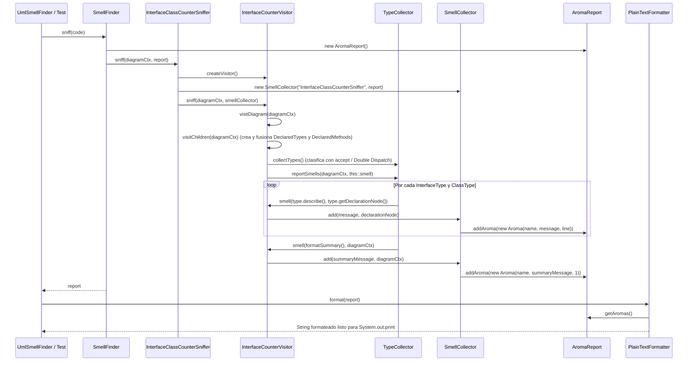
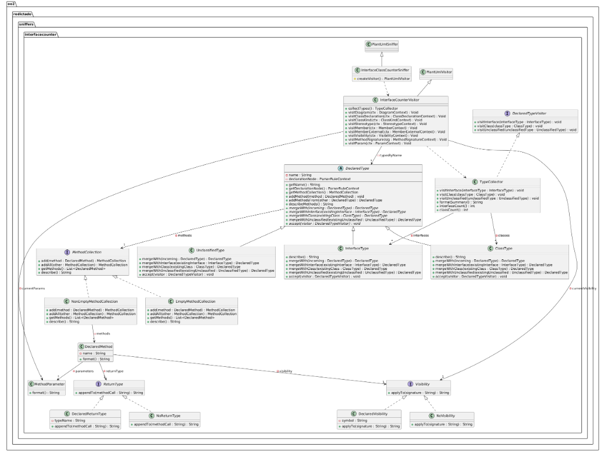
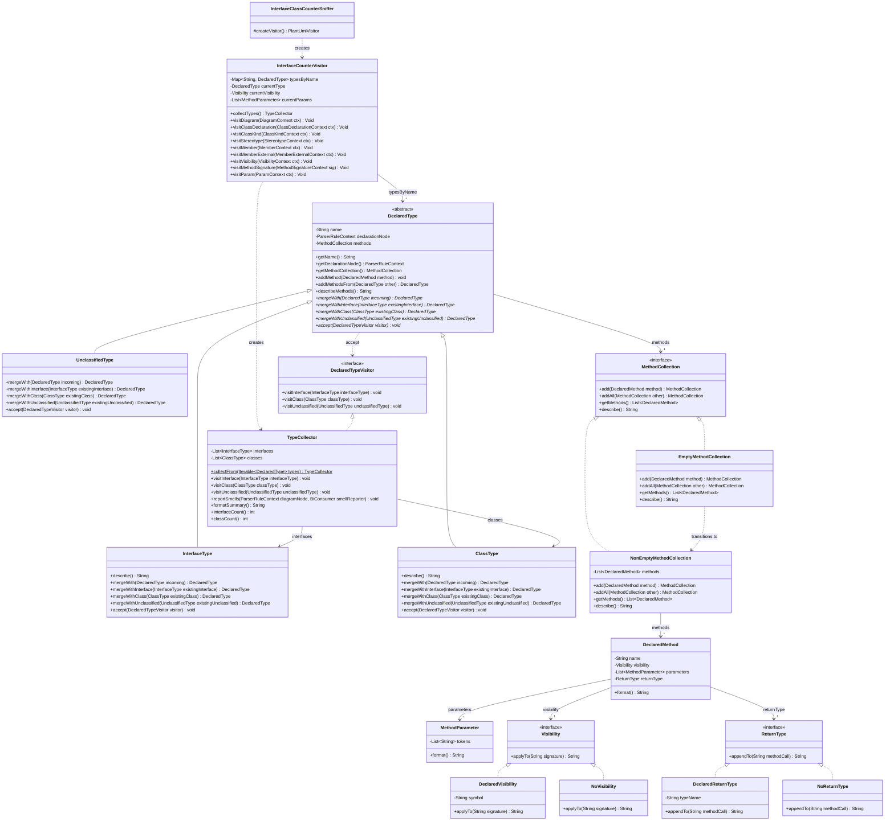
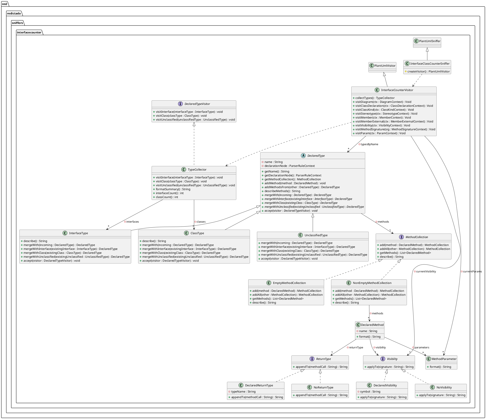

# Ejemplo de Uso del Framework: Contador de Interfaces y Clases (`ejemploDeUsoDelFramework`)

Sniffer orientado a objetos construido sobre el framework **`uml-smell-finder`** (`oo2.redictado`).

El módulo analiza diagramas de clases de PlantUML (`.puml`), detecta todas las interfaces y clases declaradas, contabiliza sus totales y extrae las firmas completas de sus métodos, delegando el parseo, la recolección de hallazgos y el formateo al framework.

---

## 1. Por qué se utilizaron las clases del framework `uml-smell-finder`

Un framework define una arquitectura con partes fijas (*frozen spots*) e invariantes de ejecución, dejando puntos de extensión (*hot spots*) donde la solución enchufa únicamente su lógica específica mediante inversión de control (*Hollywood Principle: "Don't call us, we'll call you"*).

| Clase del Framework | Rol en el Framework (*Frozen / Hot Spot*) | Por qué y cómo se utiliza en nuestra solución |
| :--- | :--- | :--- |
| [`PlantUmlSniffer`](../src/main/java/oo2/redictado/plantuml/PlantUmlSniffer.java) | **Hot Spot (Template Method)**. Subclase de [`VisitorSniffer<DiagramContext>`](../src/main/java/oo2/redictado/core/VisitorSniffer.java) que implementa [`CodeSniffer<DiagramContext>`](../src/main/java/oo2/redictado/core/CodeSniffer.java). | [`InterfaceClassCounterSniffer`](./src/main/java/oo2/redictado/sniffers/interfacecounter/InterfaceClassCounterSniffer.java) hereda de ella y únicamente implementa `createVisitor()`, dejando que `VisitorSniffer.sniff(...)` instancie el [`SmellCollector`](../src/main/java/oo2/redictado/core/SmellCollector.java) y ejecute el recorrido sobre el árbol. |
| [`PlantUmlVisitor`](../src/main/java/oo2/redictado/plantuml/PlantUmlVisitor.java) | **Hot Spot (Visitor sobre ANTLR4)**. Extiende `PlantUmlParserBaseVisitor<Void>` e implementa [`SmellVisitor<DiagramContext>`](../src/main/java/oo2/redictado/core/SmellVisitor.java). | [`InterfaceCounterVisitor`](./src/main/java/oo2/redictado/sniffers/interfacecounter/InterfaceCounterVisitor.java) extiende esta clase para redefinir solo las reglas gramaticales relevantes (`visitDiagram`, `visitClassDeclaration`, `visitClassKind`, `visitStereotype`, `visitMember`, `visitMemberExternal`, `visitVisibility`, `visitMethodSignature`, `visitParam`) e invocar el método protegido `smell(mensaje, ctx)` provisto por el framework. |
| [`SnifferCatalog`](../src/main/java/oo2/redictado/core/SnifferCatalog.java) | **Frozen Spot (Fábrica y Registro de Sniffers)**. Gestiona la instanciación y selección de sniffers desde CLI o código. | Permite registrar nuestro sniffer con `catalog.add("InterfaceClassCounterSniffer", params -> new InterfaceClassCounterSniffer())` y ejecutarlo aisladamente o en serie mediante [`SerialSniffer`](../src/main/java/oo2/redictado/core/SerialSniffer.java). |
| [`PlantUml`](../src/main/java/oo2/redictado/plantuml/PlantUml.java) | **Frozen Spot (Implementación de [`Language<DiagramContext>`](../src/main/java/oo2/redictado/core/Language.java))**. | El framework se encarga de invocar el lexer (`PlantUmlLexer`) y el parser (`PlantUmlParser`) de ANTLR4, validando errores sintácticos y entregando el `DiagramContext` al sniffer. |
| [`SmellCollector`](../src/main/java/oo2/redictado/core/SmellCollector.java), [`Aroma`](../src/main/java/oo2/redictado/core/Aroma.java) y [`AromaReport`](../src/main/java/oo2/redictado/core/AromaReport.java) | **Frozen Spot (Modelo de Reporte)**. | Cuando [`InterfaceCounterVisitor`](./src/main/java/oo2/redictado/sniffers/interfacecounter/InterfaceCounterVisitor.java) llama a `this.smell(mensaje, nodo)`, el `SmellCollector` del framework obtiene la línea del `ParserRuleContext` y registra el `Aroma` en el `AromaReport`. |
| [`SmellFinder`](../src/main/java/oo2/redictado/core/SmellFinder.java) y [`PlainTextFormatter`](../src/main/java/oo2/redictado/core/PlainTextFormatter.java) | **Frozen Spot (Orquestador y Strategy de Formateo)**. | Orquestan el parseo, la ejecución del sniffer y la conversión del `AromaReport` en texto. |

---

## 2. Explicación de la Solución y Responsabilidad de Cada Clase

La solución está diseñada de forma íntegramente orientada a objetos (**sin usar `if`, `else`, `switch`, operador ternario ni `instanceof`**), apoyándose en polimorfismo, **Double Dispatch**, **Visitor**, **State** y **Null Object**.

### 2.1. Punto de Entrada al Framework y Recorrido del AST
- **[`InterfaceClassCounterSniffer`](./src/main/java/oo2/redictado/sniffers/interfacecounter/InterfaceClassCounterSniffer.java)**: subclase de `PlantUmlSniffer`. Su única responsabilidad es fabricar una nueva instancia de [`InterfaceCounterVisitor`](./src/main/java/oo2/redictado/sniffers/interfacecounter/InterfaceCounterVisitor.java) en `createVisitor()` (*Template Method*) para cada análisis.
- **[`InterfaceCounterVisitor`](./src/main/java/oo2/redictado/sniffers/interfacecounter/InterfaceCounterVisitor.java)**: subclase de `PlantUmlVisitor` que recorre el árbol sintáctico de PlantUML generado por ANTLR4:
  - En `visitClassDeclaration`, `visitClassKind`, `visitStereotype` y `visitMemberExternal` construye y registra instancias de [`DeclaredType`](./src/main/java/oo2/redictado/sniffers/interfacecounter/DeclaredType.java) dentro del mapa `typesByName`, fusionando declaraciones repetidas o promociones mediante Double Dispatch.
  - En `visitMember`, `visitVisibility`, `visitMethodSignature` y `visitParam` ensambla objetos [`DeclaredMethod`](./src/main/java/oo2/redictado/sniffers/interfacecounter/DeclaredMethod.java) con sus colaboradores y los agrega al tipo actual.
  - Al finalizar `visitDiagram`, clasifica todos los tipos recolectados con [`TypeCollector`](./src/main/java/oo2/redictado/sniffers/interfacecounter/TypeCollector.java) y reporta los resultados mediante `this::smell`.

### 2.2. Jerarquía de Tipos Declarados (*Double Dispatch* y *Null Object*)
En PlantUML un mismo tipo puede aparecer en varios lugares del diagrama (por ejemplo: declarado primero como miembro externo `Notificador : + inicializar() : void` y luego como `interface Notificador`; o definido como `class Logger <<interface>>` donde el estereotipo lo promueve a interfaz; o ser un `enum` que debe ignorarse).

- **[`DeclaredType`](./src/main/java/oo2/redictado/sniffers/interfacecounter/DeclaredType.java)**: clase abstracta que representa cualquier tipo del diagrama. Conoce su nombre (`name`), el nodo del AST donde fue declarado (`declarationNode`) y su colección de métodos (`MethodCollection`). Define los contratos de **Double Dispatch** tanto para fusionar declaraciones (`mergeWith`, `mergeWithInterface`, `mergeWithClass`, `mergeWithUnclassified`) como para ser visitado (`accept(DeclaredTypeVisitor)`).
- **[`InterfaceType`](./src/main/java/oo2/redictado/sniffers/interfacecounter/InterfaceType.java)**: representa una interfaz declarada con `interface Nombre` o mediante estereotipo `<<interface>>`. Sabe describirse (`"Interfaz " + nombre + ": " + métodos`), promover un `ClassType` o `UnclassifiedType` previo a `InterfaceType` conservando sus métodos y despachar a `visitor.visitInterface(this)`.
- **[`ClassType`](./src/main/java/oo2/redictado/sniffers/interfacecounter/ClassType.java)**: representa una clase concreta o abstracta (`class`, `abstract class`, `abstract`). Sabe describirse (`"Clase " + nombre + ": " + métodos`), promover un `UnclassifiedType` previo a `ClassType`, ceder ante una `InterfaceType` si se fusiona con ella y despachar a `visitor.visitClass(this)`.
- **[`UnclassifiedType`](./src/main/java/oo2/redictado/sniffers/interfacecounter/UnclassifiedType.java)**: *Null Object* que representa un tipo aún no clasificado (como el receptor de un miembro externo antes de su declaración formal) o un elemento que no es ni clase ni interfaz (como `enum`, `entity` o un estereotipo distinto de `<<interface>>`). Al fusionarse con una clase o interfaz traslada sus métodos acumulados sin alterar la categoría del otro tipo, y al ser visitado despacha a `visitor.visitUnclassified(this)`.

| Tipo previo (`existing`) \ Tipo entrante (`incoming`) | `InterfaceType` (entrante) | `ClassType` (entrante) | `UnclassifiedType` (entrante) |
| :--- | :--- | :--- | :--- |
| **`InterfaceType` (previo)** | `InterfaceType` (acumula métodos) | `InterfaceType` (preserva interfaz y acumula métodos) | `InterfaceType` (acumula métodos externos) |
| **`ClassType` (previo)** | **Promueve a `InterfaceType`** (preserva nodo y métodos previos + nuevos) | `ClassType` (acumula métodos) | `ClassType` (acumula métodos externos) |
| **`UnclassifiedType` (previo)** | **Promueve a `InterfaceType`** (usa nodo de declaración de la interfaz y acumula métodos previos) | **Promueve a `ClassType`** (usa nodo de declaración de la clase y acumula métodos previos) | `UnclassifiedType` (acumula métodos) |

### 2.3. Clasificación y Reporte de Tipos (*Visitor* + *Double Dispatch*)
- **[`DeclaredTypeVisitor`](./src/main/java/oo2/redictado/sniffers/interfacecounter/DeclaredTypeVisitor.java)**: interfaz del patrón Visitor sobre la jerarquía `DeclaredType` con los métodos `visitInterface(InterfaceType)`, `visitClass(ClassType)` y `visitUnclassified(UnclassifiedType)`.
- **[`TypeCollector`](./src/main/java/oo2/redictado/sniffers/interfacecounter/TypeCollector.java)**: implementación de `DeclaredTypeVisitor` que separa las instancias de `InterfaceType` y `ClassType` en sus respectivas colecciones e ignora `UnclassifiedType` sin condicionales. Contabiliza la cantidad de interfaces (`interfaceCount()`) y clases (`classCount()`), formatea el resumen (`formatSummary()`) y vuelca todos los hallazgos al recolector del framework en `reportSmells(...)`.

### 2.4. Colección Polimórfica de Métodos (*State* / *Null Object*)
- **[`MethodCollection`](./src/main/java/oo2/redictado/sniffers/interfacecounter/MethodCollection.java)**: interfaz que modela la colección de métodos de un `DeclaredType`, definiendo las operaciones `add(DeclaredMethod)`, `addAll(MethodCollection)`, `getMethods()` y `describe()`.
- **[`EmptyMethodCollection`](./src/main/java/oo2/redictado/sniffers/interfacecounter/EmptyMethodCollection.java)**: estado inicial (*Null Object*) de todo `DeclaredType` cuando aún no tiene métodos. Responde `"(sin métodos)"` en `describe()`, devuelve la otra colección intacta en `addAll(other)` y, al recibir su primer método en `add(method)`, transiciona de estado creando una instancia de [`NonEmptyMethodCollection`](./src/main/java/oo2/redictado/sniffers/interfacecounter/NonEmptyMethodCollection.java).
- **[`NonEmptyMethodCollection`](./src/main/java/oo2/redictado/sniffers/interfacecounter/NonEmptyMethodCollection.java)**: estado de un tipo que posee uno o más métodos. Acumula nuevos [`DeclaredMethod`](./src/main/java/oo2/redictado/sniffers/interfacecounter/DeclaredMethod.java) y en `describe()` formatea cada método uniéndolos con `", "`.

### 2.5. Objetos de Dominio para Firmas de Métodos, Parámetros, Visibilidad y Retorno
- **[`DeclaredMethod`](./src/main/java/oo2/redictado/sniffers/interfacecounter/DeclaredMethod.java)**: representa un método declarado en el diagrama. Encapsula su nombre, su [`Visibility`](./src/main/java/oo2/redictado/sniffers/interfacecounter/Visibility.java), su lista de [`MethodParameter`](./src/main/java/oo2/redictado/sniffers/interfacecounter/MethodParameter.java) y su [`ReturnType`](./src/main/java/oo2/redictado/sniffers/interfacecounter/ReturnType.java), y construye su firma completa delegando polimórficamente en ellos:
  ```java
  return this.visibility.applyTo(this.returnType.appendTo(baseSignature));
  ```
- **[`MethodParameter`](./src/main/java/oo2/redictado/sniffers/interfacecounter/MethodParameter.java)**: representa un parámetro formal de un método (tanto en notación UML `nombre : Tipo` como en notación Java `Tipo nombre`) y sabe formatearse uniendo sus tokens con espacios.
- **[`Visibility`](./src/main/java/oo2/redictado/sniffers/interfacecounter/Visibility.java)**: interfaz que define cómo se aplica la visibilidad a la firma de un método (`applyTo(String signature)`).
  - **[`DeclaredVisibility`](./src/main/java/oo2/redictado/sniffers/interfacecounter/DeclaredVisibility.java)**: representa una visibilidad explícita (`+`, `-`, `#`, `~`) y la antepone a la firma separada por un espacio.
  - **[`NoVisibility`](./src/main/java/oo2/redictado/sniffers/interfacecounter/NoVisibility.java)**: *Null Object* utilizado cuando el método no especifica símbolo de visibilidad; devuelve la firma sin cambios.
- **[`ReturnType`](./src/main/java/oo2/redictado/sniffers/interfacecounter/ReturnType.java)**: interfaz que define cómo se adjunta el tipo de retorno a la firma de un método (`appendTo(String methodCall)`).
  - **[`DeclaredReturnType`](./src/main/java/oo2/redictado/sniffers/interfacecounter/DeclaredReturnType.java)**: representa un tipo de retorno explícito y concatena `" : " + typeName` al final de la firma.
  - **[`NoReturnType`](./src/main/java/oo2/redictado/sniffers/interfacecounter/NoReturnType.java)**: *Null Object* utilizado cuando el método no declara tipo de retorno; devuelve la firma intacta.

---

## 3. Cómo se Carga la Información para Imprimir (Flujo Paso a Paso)

En `uml-smell-finder`, ningún sniffer escribe por consola (`System.out.println`). En su lugar, la información se **carga como objetos [`Aroma`](../src/main/java/oo2/redictado/core/Aroma.java) dentro de un [`AromaReport`](../src/main/java/oo2/redictado/core/AromaReport.java)** a través del [`SmellCollector`](../src/main/java/oo2/redictado/core/SmellCollector.java), y el framework se encarga de formatearla e imprimirla al final.

El proceso completo ocurre en **5 etapas**:

### Etapa 1: Inicialización del `AromaReport` y del `SmellCollector` (en el Framework)
1. [`SmellFinder.sniff(code)`](../src/main/java/oo2/redictado/core/SmellFinder.java#L24-L28) crea un [`AromaReport`](../src/main/java/oo2/redictado/core/AromaReport.java) vacío y parsea el código PlantUML con [`PlantUml.parse(code)`](../src/main/java/oo2/redictado/plantuml/PlantUml.java#L17-L26) para obtener la raíz del árbol sintáctico (`DiagramContext`).
2. [`VisitorSniffer.sniff(tree, report)`](../src/main/java/oo2/redictado/core/VisitorSniffer.java#L17-L19) invoca `createVisitor()` en [`InterfaceClassCounterSniffer`](./src/main/java/oo2/redictado/sniffers/interfacecounter/InterfaceClassCounterSniffer.java) (obteniendo una nueva instancia de [`InterfaceCounterVisitor`](./src/main/java/oo2/redictado/sniffers/interfacecounter/InterfaceCounterVisitor.java)) y crea un [`SmellCollector(this.name(), report)`](../src/main/java/oo2/redictado/core/SmellCollector.java) vinculado al `AromaReport`.
3. [`PlantUmlVisitor.sniff(diagram, smells)`](../src/main/java/oo2/redictado/plantuml/PlantUmlVisitor.java#L25-L28) guarda el `SmellCollector` en su atributo `this.smells` y dispara el recorrido del árbol llamando a `this.visit(diagram)`.

### Etapa 2: Recolección de Tipos y Métodos durante el Recorrido del AST (en `InterfaceCounterVisitor`)
Cuando comienza [`visitDiagram(DiagramContext ctx)`](./src/main/java/oo2/redictado/sniffers/interfacecounter/InterfaceCounterVisitor.java#L37-L41), primero se ejecuta `visitChildren(ctx)` para recorrer todo el árbol de ANTLR4:
- **Al visitar una declaración (`visitClassDeclaration`)**:
  - Se instancia inicialmente `this.currentType = new ClassType(name, ctx)` guardando el nodo `ctx` (`ParserRuleContext`) donde está el número de línea de la declaración.
  - Al bajar a `visitClassKind` y `visitStereotype`, `currentType` se transforma o promueve polimórficamente en [`InterfaceType`](./src/main/java/oo2/redictado/sniffers/interfacecounter/InterfaceType.java), [`ClassType`](./src/main/java/oo2/redictado/sniffers/interfacecounter/ClassType.java) o [`UnclassifiedType`](./src/main/java/oo2/redictado/sniffers/interfacecounter/UnclassifiedType.java).
- **Al visitar miembros internos (`visitMember`) o externos (`visitMemberExternal`)**:
  - `visitVisibility` instancia [`DeclaredVisibility`](./src/main/java/oo2/redictado/sniffers/interfacecounter/DeclaredVisibility.java) (o queda [`NoVisibility`](./src/main/java/oo2/redictado/sniffers/interfacecounter/NoVisibility.java) por defecto).
  - `visitParam` instancia cada [`MethodParameter`](./src/main/java/oo2/redictado/sniffers/interfacecounter/MethodParameter.java).
  - `visitMethodSignature` extrae el [`ReturnType`](./src/main/java/oo2/redictado/sniffers/interfacecounter/ReturnType.java) ([`DeclaredReturnType`](./src/main/java/oo2/redictado/sniffers/interfacecounter/DeclaredReturnType.java) o [`NoReturnType`](./src/main/java/oo2/redictado/sniffers/interfacecounter/NoReturnType.java)), construye el objeto [`DeclaredMethod`](./src/main/java/oo2/redictado/sniffers/interfacecounter/DeclaredMethod.java) y lo agrega al tipo actual con `this.currentType.addMethod(...)` (lo que hace transicionar su [`MethodCollection`](./src/main/java/oo2/redictado/sniffers/interfacecounter/MethodCollection.java) de [`EmptyMethodCollection`](./src/main/java/oo2/redictado/sniffers/interfacecounter/EmptyMethodCollection.java) a [`NonEmptyMethodCollection`](./src/main/java/oo2/redictado/sniffers/interfacecounter/NonEmptyMethodCollection.java)).
- **Al finalizar el bloque del tipo (`registerType`)**:
  - Se guarda o fusiona en el mapa `typesByName` usando Double Dispatch (`existing.mergeWith(type)`).

### Etapa 3: Clasificación y Armado de las Descripciones (`TypeCollector` y Objetos de Dominio)
Una vez que `visitChildren(ctx)` recorrió todos los nodos del diagrama, [`visitDiagram`](./src/main/java/oo2/redictado/sniffers/interfacecounter/InterfaceCounterVisitor.java#L39) ejecuta:
```java
this.collectTypes().reportSmells(ctx, this::smell);
```
1. `TypeCollector.collectFrom(this.typesByName.values())` recorre los tipos registrados ejecutando `type.accept(collector)`:
   - Cada [`InterfaceType`](./src/main/java/oo2/redictado/sniffers/interfacecounter/InterfaceType.java) se registra en `interfaces`.
   - Cada [`ClassType`](./src/main/java/oo2/redictado/sniffers/interfacecounter/ClassType.java) se registra en `classes`.
   - Cada [`UnclassifiedType`](./src/main/java/oo2/redictado/sniffers/interfacecounter/UnclassifiedType.java) (ej. `enum`) se ignora polimórficamente en `visitUnclassified`.
2. Cada tipo construye su propio texto mediante `describe()`:
   - `InterfaceType.describe()` → `"Interfaz " + getName() + ": " + describeMethods()`
   - `ClassType.describe()` → `"Clase " + getName() + ": " + describeMethods()`
   - `describeMethods()` delega polimórficamente en `MethodCollection.describe()`:
     - Si el tipo no tiene métodos ([`EmptyMethodCollection`](./src/main/java/oo2/redictado/sniffers/interfacecounter/EmptyMethodCollection.java)), devuelve `"(sin métodos)"`.
     - Si tiene métodos ([`NonEmptyMethodCollection`](./src/main/java/oo2/redictado/sniffers/interfacecounter/NonEmptyMethodCollection.java)), pide `format()` a cada [`DeclaredMethod`](./src/main/java/oo2/redictado/sniffers/interfacecounter/DeclaredMethod.java) y los une con `", "`.

### Etapa 4: Carga en el `SmellCollector` y `AromaReport` (`reportSmells` → `this::smell`)
Dentro de [`TypeCollector.reportSmells(diagramNode, smellReporter)`](./src/main/java/oo2/redictado/sniffers/interfacecounter/TypeCollector.java#L38-L46):
```java
public void reportSmells(
        ParserRuleContext diagramNode,
        BiConsumer<String, ParserRuleContext> smellReporter) {
    this.interfaces.forEach(
            i -> smellReporter.accept(i.describe(), i.getDeclarationNode()));
    this.classes.forEach(
            c -> smellReporter.accept(c.describe(), c.getDeclarationNode()));
    smellReporter.accept(this.formatSummary(), diagramNode);
}
```
Cada llamada a `smellReporter.accept(mensaje, nodo)` invoca `this.smell(mensaje, nodo)` en [`PlantUmlVisitor`](../src/main/java/oo2/redictado/plantuml/PlantUmlVisitor.java#L36-L38), que delega en [`SmellCollector.add(mensaje, where)`](../src/main/java/oo2/redictado/core/SmellCollector.java#L21-L24):
```java
public void add(String message, ParserRuleContext where) {
    int line = where.getStart().getLine();
    this.report.addAroma(new Aroma(this.snifferName, message, line));
}
```
Aquí el `SmellCollector` toma automáticamente el número de línea del nodo de ANTLR4 (`where.getStart().getLine()`) y agrega el objeto `Aroma("InterfaceClassCounterSniffer", message, line)` a la lista interna del [`AromaReport`](../src/main/java/oo2/redictado/core/AromaReport.java).

### Etapa 5: Formateo e Impresión en Texto Plano (en el Framework)
1. `SmellFinder.sniff(code)` devuelve el `AromaReport` completo con todos los `Aroma`s cargados.
2. [`PlainTextFormatter.format(report)`](../src/main/java/oo2/redictado/core/PlainTextFormatter.java#L8-L16) recorre `report.getAromas()` y convierte cada `Aroma` en una línea de texto:
   ```java
   "[%s] line %d: %s%n".formatted(aroma.name(), aroma.line(), aroma.message())
   ```
3. [`UmlSmellFinder.main`](../src/main/java/oo2/redictado/UmlSmellFinder.java#L41-L42) imprime el resultado con `System.out.print(formatter.format(finder.sniff(code)))`.

### Diagrama de Secuencia del Flujo de Carga e Impresión



---

## 4. Diagrama UML de la Solución



### Vista en Mermaid (clases de la solución)



### Especificación en PlantUML (solo paquete de la solución)



---

## 5. Cómo compilar y correr los Tests

1. Instalar el framework `uml-smell-finder` en el repositorio local de Maven desde la raíz del proyecto:
   ```bash
   ./mvnw install -DskipTests
   ```
   *(En Windows PowerShell: `.\mvnw.cmd install -DskipTests`)*.

2. Ejecutar la suite de pruebas unitarias ([`InterfaceClassCounterSnifferTest`](./src/test/java/oo2/redictado/sniffers/interfacecounter/InterfaceClassCounterSnifferTest.java)):
   ```bash
   ./mvnw -f ejemploDeUsoDelFramework/pom.xml test
   ```
   *(En Windows PowerShell: `.\mvnw.cmd -f ejemploDeUsoDelFramework\pom.xml test`)*.

---

## 6. Ejemplo de Salida desde el Framework

Para el diagrama [`ejemplo.puml`](./ejemplo.puml):

```text
[InterfaceClassCounterSniffer] line 2: Interfaz Repositorio: + guardar()
[InterfaceClassCounterSniffer] line 6: Interfaz Autenticable: (sin métodos)
[InterfaceClassCounterSniffer] line 8: Interfaz Logger: + log(msg : String)
[InterfaceClassCounterSniffer] line 12: Clase Usuario: (sin métodos)
[InterfaceClassCounterSniffer] line 16: Clase EntidadBase: (sin métodos)
[InterfaceClassCounterSniffer] line 1: Interfaces encontradas: 3, Clases encontradas: 2
```
